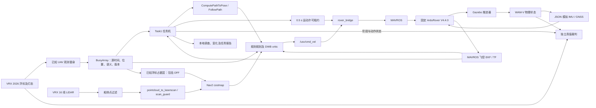

# RobotX 2026 Task 1 实施记录

依据：2026-10-23 官方手册，Task 1 第 71–74 页、评分第 114–117 页；下载与校验见 `sources.json`。

实现范围：2026 RoboBuoy、已知位置和语义灯态替身、WAM-V 船端规划、独立本地裁判。正式 UAV 感知/飞行与 RoboCommand 未实现；本地报告不能计为正式比赛得分。WAM-V 超过本届 2 m × 1 m × 1 m 参赛尺寸，结果仅代表本船模的软件验证。

规则：十个浮标；闪烁周期亮一秒/灭一秒；闪蓝入口先顺时针绕完整一圈；常蓝出口最后逆时针绕完整一圈；红在右舷、绿在左舷；正横时同侧最近浮标才计通过；OFF 仍是实体障碍。语义状态与亮灭相位独立。

控制：Nav2 → rover_bridge → MAVROS → ArduRover V4.4.0 (`d0356316eb0fa34ed1c9f39f7b059b9ae7ba4664`) → VRX。规划定位来自飞控 EKF；真值只供裁判和模拟观测。灯态改变先取消、发零、实测停车，再求解新路。停车不等于推力归零，仿真冻结不算停车。

交付阶段：模型及观测 → 规则规划及离线测试 → 闭环和切换 → 动态障碍、异常、视频与报告。失败运行保留在 runs；最终验证状态另见 validation.md。当前文档不是通过报告。

“已知 UAV”目前直接读取场景的浮标配置与灯态，未从相机图像识别；摄像头用于检查新模型及保存证据。Task1 不订阅船体真值作为导航定位，动态障碍轨迹也不注入规划器。独立裁判读取真实运动、接触和灯变生效时间，分别检查规则和停车。

控制器以 EKF 判断绕圈时额外要求 0.05 rad 的累计角度余量；独立裁判仍要求真值完整 2π 和回到绕圈起点附近。该余量用于吸收 EKF 与真值的小差异，不能作为降低完整绕圈标准的理由。
